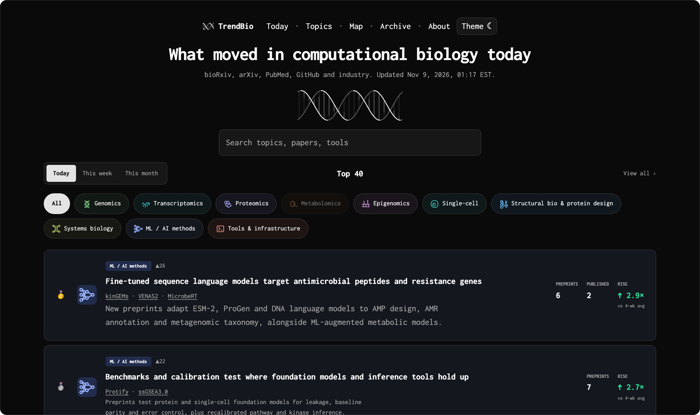
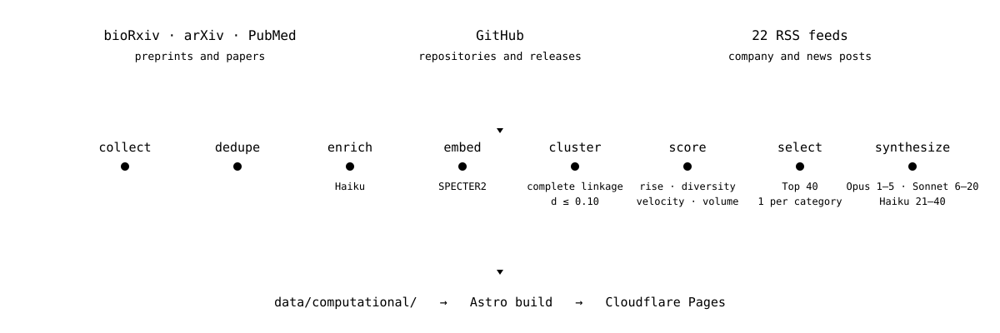

<p align="center">
  <picture>
    <source media="(prefers-color-scheme: light)" srcset="docs/readme/helix-light.svg">
    
  </picture>
</p>

<h1 align="center">TrendBio</h1>

<p align="center">What is moving in computational biology, ranked every day.</p>

<p align="center">
  <a href="https://trendbio.dev">trendbio.dev</a>&ensp;·&ensp;<a href="https://trendbio.dev/feed.xml">Atom feed</a>&ensp;·&ensp;<a href="https://trendbio.dev/about">How it works</a>
</p>

<br>

<picture>
  <source media="(prefers-color-scheme: light)" srcset="docs/readme/home-light.png">
  
</picture>

<br>

TrendBio reads each day's new preprints, papers, repositories and company posts in computational biology, groups them into research topics, ranks the Top 40 and writes a short synthesis for each. One page a day, for readers who already know the field, with history back to 1 November 2025.

## How a day is made

<picture>
  <source media="(prefers-color-scheme: light)" srcset="docs/readme/pipeline-light.svg">
  
</picture>

| Source | Scope |
|---|---|
| bioRxiv | 7 categories, 2 of them keyword-filtered |
| arXiv | `q-bio.*`, plus keyword-filtered `cs.LG`, `cs.AI` and `stat.ML` |
| PubMed | 21 journals in full, 16 more keyword-filtered; copies of bioRxiv and medRxiv preprints dropped |
| GitHub | 20 watched repositories and 8 topic searches; stars and releases |
| RSS | 22 feeds: 18 company and institute blogs, 4 keyword-filtered news feeds |

| Stage | What happens |
|---|---|
| Dedupe | Preprint versions collapse into one item; preprints link to their published versions when known |
| Enrich | Claude Haiku judges relevance and writes a one-line summary; numbers are checked against the title and abstract |
| Cluster | SPECTER2 embeddings, complete linkage at cosine distance 0.10, at least 3 papers per topic |
| Attach | Code and industry items join their nearest topic at similarity ≥ 0.94, as evidence, never as paper counts |
| Score | rise 45 % · diversity 25 % · code velocity 15 % · volume 15 %, with a 5 % penalty for ranking yesterday |
| Select | 1 topic reserved per represented category, at most 8 per category, Top 40 |
| Synthesize | Opus for ranks 1–5, Sonnet for 6–20, Haiku for 21–40 and for backfilled history |

A topic keeps its page across days when a new cluster shares its recent papers (Jaccard ≥ 0.25) or sits on its centroid (similarity ≥ 0.95) within 10 days, so rank changes and history are real.

## The site

Full rows for the Top 5 and compact rows to 20, with rank changes and the tool names each topic mentions; forty on request. Every topic links its evidence, exports BibTeX and keeps a day-by-day history. Weekly and monthly rankings, a topic map and a year of archive pages sit beside it. Three side lists catch what clustering misses: **From code**, **From industry** and **Shared by researchers**, the last from Bluesky and display only. Search is instant and local (Pagefind), feeds are Atom (daily Top 5 and per category), times are US Eastern, and the theme follows yours.

Astro 5 on Cloudflare Pages. No cookies: Cloudflare Web Analytics counts page views.

## Schedule and cost

A [Cloudflare Worker](ops/daily-trigger/) starts the run at 06:05 UTC; GitHub's own schedule is the late-arriving backup and skips when a run already succeeded that UTC day with every core source; if bioRxiv, arXiv or PubMed failed, it redoes the day. About ten minutes later the run commits to `data/computational/` and the site rebuilds.

LLM spend is about USD 0.50 a day against a USD 55 monthly ceiling; past the ceiling, new syntheses fall back to Haiku and the day is marked degraded. From Bluesky only aggregate counts, paper IDs and per-host coverage are kept, never identities, post text or credentials.

## Run it yourself

Python 3.12 and Node 22. `ANTHROPIC_API_KEY` for live pipeline commands; `NCBI_API_KEY` and `GITHUB_TOKEN` optional, for higher rate limits.

```sh
pip install -e '.[dev]'
pytest -q
python -m pipeline run --dry-run

cd site
npm ci
npx playwright install --with-deps chromium
npm test
npm run dev                                       # synthetic fixtures
TRENDBIO_DATA_ROOT=../data npm run build          # the real year of data
```

## Repository map

```
config/     sources, scoring weights, category taxonomy
pipeline/   collect → dedupe → enrich → embed → cluster → score → synthesize
data/       the database: one JSON file per day, topic and item, committed by the pipeline
site/       the Astro site, rebuilt from data/ after every push and pipeline run
notes/      optional editor's notes, one Markdown file per topic slug
ops/        the Cloudflare trigger Worker and the Bluesky probe
tests/      pipeline tests and calibration evidence
docs/       design spec, implementation plans, operations guide
```

## Documentation

[Design spec](docs/superpowers/specs/2026-11-02-trendbio-design.md)&ensp;·&ensp;[Operations](docs/operations.md)&ensp;·&ensp;[Implementation plans](docs/superpowers/plans/)

## License

Code is [MIT](LICENSE). What the pipeline produces under `data/`, from headlines to rankings, is [CC BY 4.0](data/LICENSE), cited as TrendBio (trendbio.dev). Paper titles, abstracts and author names belong to their authors and publishers.

<p align="center"><sub>Headlines, summaries and syntheses are machine-generated and can be wrong; follow the evidence links before relying on a claim.&ensp;·&ensp;jaemin6013@gmail.com</sub></p>
